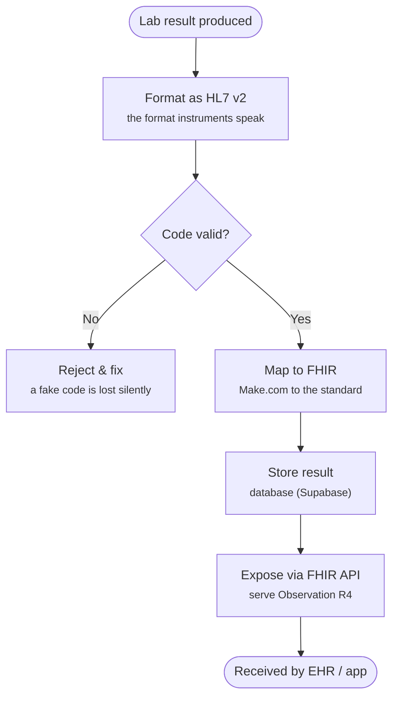

# Lab result → FHIR

Turning raw laboratory results into a standardised, interoperable **FHIR** output —
a proof of concept built on my own lab data.

## The idea

A lab measurement is only useful if other systems can read it. This project takes a
result from the bench, formats it the way instruments speak (**HL7 v2**), checks the
code is real, and serves it as a **FHIR Observation** that any clinical system can consume.

## The flow



## Example output

A pipette QC result (device P12556), mapped to a FHIR R4 `Observation`:

```json
{
  "resourceType": "Observation",
  "status": "final",
  "category": [{ "coding": [{ "code": "laboratory" }] }],
  "code": { "coding": [{ "system": "urn:omar-dahir:lab-codes", "code": "PIPETTE_MEAN_VOL",
                         "display": "Mean volume 1000uL" }] },
  "subject": { "reference": "Device/P12556" },
  "performer": [{ "display": "Omar (lab operator)" }],
  "valueQuantity": { "value": 998.5, "unit": "uL",
                     "system": "http://unitsofmeasure.org", "code": "uL" },
  "referenceRange": [{ "low": { "value": 994 }, "high": { "value": 1006 } }],
  "interpretation": [{ "coding": [{ "code": "N", "display": "Normal / in-spec" }] }]
}
```

> The code uses my own namespace (`urn:omar-dahir:lab-codes`) — **not** a fake LOINC code.
> Equipment QC doesn't fit LOINC, so claiming it would be dishonest and would break on validation.

## What I built vs. production

| Stage | This proof of concept | Production equivalent |
|-------|----------------------|-----------------------|
| Source | Own lab data (simulated feed) | Analyser → HL7 v2 |
| Integration | Make.com | Mirth Connect |
| Store | Supabase (PostgreSQL) | LIMS / clinical database |
| API | Make webhook | HAPI FHIR server |
| Output | FHIR Observation (R4) | FHIR Observation (R4) |

I built the back end (integration → store → FHIR output) and simulated/understood the
front end (instrument → HL7). I don't claim to have run Mirth or a real LIMS — this shows
the chain works *and* that I know the production-grade equivalents.

## A note on data integrity

The one thing that silently breaks interoperability is a **fake code** — for example an
invented code claiming to be LOINC. A receiving system looks it up, finds nothing, and the
result is lost with no error. Catching that is the core verification skill behind this project.

## Stack

`FHIR R4` · `HL7 v2 (ORU^R01)` · `Make.com` · `Supabase / PostgreSQL`

---

Built by [Omar](https://github.com/omar-dahir) — lab technician in training & AI/automation builder.
